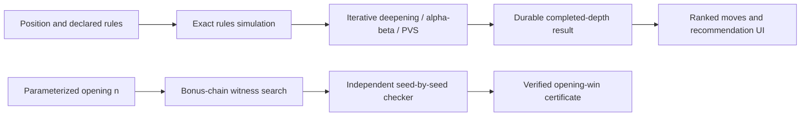

# Congklak Engine

I built a Congklak position-analysis engine with a C++20 search kernel, a Python coordinator, interruption-safe SQLite persistence and a browser move-recommendation interface. I also implemented a separate parameterized opening-witness finder and an independent seed-by-seed certificate checker.

Developed by [Vavan Farizzaman](https://github.com/VavanZaa).

## Algorithm

1. Validate stable positions against the declared relay-sowing, capture, store-bonus and empty-row-pass rule profile.
2. Search legal choices with iterative deepening, alpha-beta/PVS and a transposition table. Preserve all tied best choices and reconstruct conditional continuations.
3. Commit complete search-depth results through the Python coordinator so interrupted runs can resume without presenting incomplete rankings as finished analysis.
4. Display ranked moves, the recommendation, completed depth and finite-horizon score in the browser UI.
5. For Dakon-n openings, separately run deterministic depth-first backtracking through genuine own-store bonus chains, with arithmetic relay sowing and a bounded failed-state cache.
6. Independently replay every seed and action in a winning certificate, checking conservation, control flow and the banked majority before any opponent choice.

## Workflow



## Run

Commands below assume a Windows terminal at the repository root unless stated otherwise.

```powershell
powershell -NoProfile -ExecutionPolicy Bypass -File tools/build.ps1
py -3.12 -m congklak
# Browser app:
.\"Play Congklak.cmd"
# Pure-Python verification, without the native build:
py -3.12 -m congklak.dakon_opening_verify examples/winning-certificates/n07-majority-A/certificate.json
```

## Code map

`native/`: C++ simulator/search and retained research backends; `congklak/`: coordinator, UI service, witness finder and checker; `product_v2/`: browser UI; `rules/`: rule contract; `examples/winning-certificates/`: small verified witnesses; `tools/`: builds; `tests/`: regression checks.

## Scope and evidence

The retained witnesses establish opening wins for n=2..64 under this project's sequential, single-round rules, with n pits per side and n seeds per pit. They do not solve every possible position or other Congklak conventions, and they are not shortest-sequence proofs. Finite-depth UI scores and certificate-backed opening results are separate. Training corpora, checkpoints and bulk search databases are excluded. Native builds currently target Windows/MSVC.

This is a focused source snapshot. Installed dependencies, local environments and bulk generated research assets are rebuilt or supplied separately. See [VALIDATION.md](VALIDATION.md) for the checks performed on this export and any remaining setup requirements.
