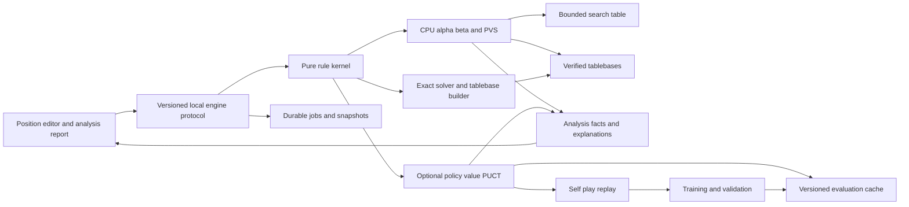

# Congklak engine architecture and implementation plan

Build a local Indonesian Congklak or Dakon position analyzer first: enter a position, compare legal moves, inspect the continuation and understand the sowing and capture consequences. The recommended starting engine is a compact C++ simulation kernel with CPU iterative deepening alpha-beta and PVS, separate rigorous bounds, and durable analysis snapshots. Add learned evaluation or GPU policy and value search only when controlled experiments show better analysis quality for the available time and energy.

The confirmed machine is an i9-13900K with 32 GB RAM and an RTX 4080 with 16 GB VRAM. Overnight work is acceptable, and interruption recovery is a release requirement. The first milestone is best-move analysis and explanations; solving the initial position or every reachable position is a later, separately gated objective.

This is the implementation plan revised through the full updated audit. The [first implementation scope](FIRST_IMPLEMENTATION.md) selects one complete experimental contract and a resumable command-line baseline. Rule choices must be frozen before reusable results are generated; matching a local physical tradition is a separate convention check. Resource numbers are starting settings, not measured performance.

## Research and decisions

Use the companion research as the source record:

- [Congklak rules research](research/congklak-rules.md) distinguishes Indonesian evidence, sequential Dakon, simultaneous openings and round rules.
- [Engine architecture research](research/engine-comparison.md) compares Stockfish, AlphaZero, Leela Chess Zero, Dragon and Torch, including which architecture details are public.
- [Compute and recovery design](research/compute-and-recovery.md) specifies local resource limits, energy measurement and checkpoint durability.
- [Database generation and training plan](DATA_AND_TRAINING_PLAN.md) specifies exact endgame coverage, position sampling, label provenance, corpus splits, evaluator training and model promotion.
- [First implementation scope](FIRST_IMPLEMENTATION.md) is the authoritative initial backlog and acceptance contract.

The architecture recommendations in this plan are adaptations for Congklak. Chess ratings, node counts and proprietary product descriptions do not establish Congklak strength or energy efficiency. Chess weights and piece features do not transfer directly to pit counts and relay sowing.

| Decision | Starting choice | Reason and change condition |
| --- | --- | --- |
| Rules | A named Indonesian sequential profile, with all uncertain edge cases explicit | The user wants Indonesian Congklak or Dakon; a generic mancala label cannot identify a game |
| Simulation | C++20 pure rules kernel plus independent slow reference interpreter | Every search, explanation and exact result depends on transition correctness |
| Initial search | Single-worker full-width alpha-beta and simple iterative deepening; TT/PVS follow | At most seven pit choices per ordinary decision give a practical auditable baseline |
| Initial evaluation | H_v1 is store difference; tactical and positional features are separate follow-ons | Gives a usable analyzer before self-play or training |
| Learned challenger | Tiny dense MLP and compact NNUE-style evaluator | Relay sowing may change many counts; incremental evaluation must earn its complexity |
| GPU challenger | Compact policy and value network with PUCT | The RTX 4080 can batch independent self-play roots; single-position latency remains a separate test |
| Exact solving | Small verified tablebases, sound score bounds and proof-producing search | Strong play and mathematical solving have different acceptance criteria |
| Persistence | SQLite job metadata and immutable bulk artifacts | Completed work survives termination; caches remain disposable accelerators |

## Rule contract before optimization

Select `id-betawi-relay7-v0` as the first experimental engineering contract. The [first implementation scope](FIRST_IMPLEMENTATION.md) resolves its rule fields completely. This implements the declared profile without asserting an official national standard or confirmation of the user's physical convention. A convention change receives a new immutable digest and separate results.

The selected contract skips the opponent's store, captures the landing seed with an occupied opposite pit, retains it when the opposite is empty and has no prior-lap capture restriction. It uses forced passes and ends only when both rows are empty. These explicit completions can be implemented now; checking the user's familiar play gates a claim of convention matching, not simulator development.

Do not silently replace this ending with a Kalah-style immediate sweep when one row becomes empty. A separate `id-sequential-sweep7-v0` can support that requested convention. Preserve the published sequential Dakon profile as a distinct research and regression profile. Simultaneous openings and multi-round refill games require their own contracts and state fields.

Every profile must specify:

| Rule field | Required detail |
| --- | --- |
| Board and numbering | Pits per side, total seeds, printed pit labels and direction of travel |
| Track | Included stores, skipped stores, source-pit behavior on later laps and closed-pit behavior |
| Relay | Whether an occupied final pit triggers pickup, and whether either player's row qualifies |
| Capture | Empty before the last deposit, opposite-pit mapping, opposite-empty condition, landing-seed treatment and eligibility history |
| Control | Bonus choice, turn ending, forced pass and opening controller |
| Ending | Both rows empty, one-side sweep, majority stop, repetition, time limit or another condition |
| Payoff | Final seed margin, WDL, or a specified multi-round match result |
| Rounds | Refill count and order, pit closure, next starter, ties and match termination |
| Opening | Sequential, simultaneous committed pit choices, or a physical timed interleaving |
| Information | Exact pit counts known to the engine; separate rules if counts are intentionally hidden |

Store canonical JSON for the complete contract and compute its digest. Attach the digest to every position, analysis, dataset, model, tablebase and proof. A human-readable rule card should accompany imported positions so that the analyzed game is visible before the user relies on its advice.

## First analysis product

The first release is a local NDJSON command-line analyzer accepting a board, stores and input controller under the selected profile. It validates counts and reports all legal candidates with completed coverage; a later board editor uses the same protocol. Seven legal pits bound the candidate count, but fully scoring each is measured work rather than an assumed cheap operation.

Preserve input controller and forced-pass events while normalizing to the actual next actor. If the input actor must pass, report that administrative action first; any subsequent pit candidates are labeled as the other player's choices. Declare score_player for ranking and convert fixed-player intervals with the proper sign and endpoint reversal.

For each candidate, return:

- Estimated final seed margin from the root player's perspective, with its decision depth, completed-turn and opponent-reply coverage, node count and elapsed time.
- Any independently justified lower and upper outcome bounds, clearly separate from the estimate.
- The principal variation, including repeated choices by the same player, forced passes and an explicit truncation marker when the continuation is incomplete.
- Immediate sowing trace, relay pickups, seeds entering the store, capture and actual next controller.
- An alternative continuation showing why the runner-up appears worse under the same analysis budget.
- Proof status, result provenance, and whether the candidate's analysis is complete at the reported horizon.

Use distinct status fields rather than a single confidence percentage:

| Field | Meaning |
| --- | --- |
| `estimate` | A heuristic or learned prediction; it can change with additional search |
| `depth_result` | A completed finite-horizon minimax result under a named evaluator and horizon policy |
| `certified_interval` | Bounds on the eventual game outcome justified by rules, verified search or tablebases |
| `proven_wdl` | Win, draw or loss established for the specified state and profile |
| `proven_margin` | Exact optimal final seed margin established |
| `best_move_proven` | This move's lower bound dominates the upper bounds of every alternative |

For a maximizing root, `lower(best) >= upper(other)` for every other move establishes that the selected move is optimal, possibly tied, only when these are sound bounds on eventual full-game outcomes. Strict inequality establishes a unique best move. A proven win does not establish the largest winning seed margin. A finite-horizon result does not establish the eventual outcome.

Search-score stability across increasing budgets can be shown as stability, not converted into an unsupported probability. If a neural WDL probability is later displayed, calibrate it on held-out verified positions and identify its model and dataset. Visit counts are PUCT work allocation, not proof or calibrated certainty.

Explanations start from structured facts. For example, a capture claim must reference a validated trace event and a pit label; a future tactical claim must reference a PV or tested alternative. Use deterministic wording first. Optional language-model prose can summarize these facts but cannot add unverified strategic causes. The sow animation replays the trace and does not alter the analyzed state.

## Modules and data flow



Keep these boundaries explicit:

1. `rules`: contracts, canonical serialization, legal actions, transitions and terminal payoff.
2. `reference`: simple independent seed-by-seed interpretation for conformance.
3. `search`: CPU search, optional PUCT, budgets and cancellation.
4. `evaluation`: deterministic heuristic, neural features and model inference.
5. `knowledge`: transposition table, evaluation cache, exact tablebase and analysis-library retrieval.
6. `jobs`: scheduling, committed work units, checkpoints and recovery.
7. `explanations`: trace facts, PV comparison and report generation.
8. `experiments`: corpora, arena matches, energy measurement and model promotion.

Use C++ for the hot simulator, search and inference interface. Python is suitable for training, benchmark orchestration and inspection. A versioned newline-delimited JSON protocol is sufficient for the first local CLI and later UI; include rule, position and objective identifiers rather than pretending chess UCI semantics already fit Congklak.

## Position layout and kernel API

For the seven-by-seven, 98-seed single-round profile, propose a small fixed state:

```text
PositionCore
  pits[2][7]       uint8 counts
  stores[2]       uint8 counts
  controller      player 0 or 1
  phase           opening, ordinary choice, round boundary, terminal
  eligibility     only flags needed by the selected contract

PositionContext
  rule_digest, state_encoding_version, objective
  optional closed_pit_mask and round or match state
  optional rule-dependent repetition or information history
```

All counts can fit in one byte for total seeds at most 255. Reject overflow and unsupported totals at import; use a different encoding for larger studies. Do not serialize compiler padding or rely on an assumed struct size. Canonical bytes have a declared field order and integer encoding.

Number each player's pits in that player's forward sowing order toward their own store. A displayed orientation map converts these indices to the board. Under this local-index convention, opposite pits on a symmetric seven-pit board map to `6 - index`; verify the mapping against fixtures rather than deriving it from screen coordinates. Do not apply a left-right reflection as an automatic game symmetry: it changes sowing direction. Player-swapping symmetry is usable only after proving the complete profile, history and payoff transform correctly.

The search state exists only at a choice boundary. Hand count, sow cursor and animation frame belong to a transient sow interpreter. They become persistent state only if a rule introduces a real choice or interaction during sowing, or if an animation needs resumable playback. Deterministic relay steps are transition work, not search branches.

Proposed API boundaries:

```text
validate(rule, state) -> ValidatedPosition or structured errors
legal_actions(rule, state) -> pit choices or a forced-control event
apply(rule, state, action, trace_mode) -> Transition
normalize_control(rule, state) -> next decision state or terminal result
terminal_payoff(rule, state, objective) -> exact integer or declared match payoff
canonical_bytes(rule, state) -> versioned exact identity
analyze(position, limits, MultiPV, on_progress) -> AnalysisJob
explain(position, action, trace, continuation, alternatives) -> ExplanationFacts
```

`Transition` contains the next validated state, actual controller, terminal status, capture and store deltas, bonus-choice reason, normalized passes and optional trace. Terminal checking has a documented order relative to capture, bonus control and pass normalization. A terminal position produces an outcome report without inventing a legal next move.

## Simulator correctness and speed

Implement the slow reference interpreter first, then a compact production kernel. Copying a roughly 20-to-32-byte simple state may beat an undo journal when relay sowing modifies most pits. Compare copy-make with a delta undo implementation using the actual trace distribution before selecting either.

Start with explicit seed deposits. Later compare precomputed sow tracks, quotient-and-remainder whole-lap distribution, precomputed transition fragments for small hands, and batch position simulation. Any accelerated lap must preserve final-pit occupancy before the last seed, own-store passage flags, skipped pits and capture eligibility. Optimize the kernel after correctness fixtures exist.

Required checks include:

- Seed conservation at decision boundaries and conservation including the hand during a traced move.
- No negative or overflowing counts; no opponent-store deposits when the contract skips it.
- Correct source-pit revisits, wraparound, relay pickups, captures, store endings and terminal ordering.
- An empty-opposite landing, a depleted-row pass and later refill of that row by sowing.
- Agreement between reference and optimized kernels on exhaustive small instances and generated legal histories.
- Complete make/unmake round trips if undo search is implemented.
- Correct root-player value through consecutive bonus choices and passes.
- Exact rule-card and board-numbering agreement for explanations.

Maintain profile-specific perft counts, state digests and move traces. A perft leaf counts pit choices at the specified decision horizon, not individual seed deposits. Record the convention for terminal nodes and normalized passes in the fixture header.

For a sequential fixed-route profile with permanent stores, investigate a termination argument: a completed choice either removes active seeds into a store or moves seeds only forward within the mover's own row. The second case can reduce the weighted distance of active seeds to their pit owner's store. A lexicographic ranking of active-seed count and this distance is a proposed proof obligation, not a property inherited from Kalah. Relay termination also needs its own finite-route argument. Validate all assumptions against the frozen capture and pass policy. Refill rounds and physical simultaneous interleavings require different arguments.

## CPU search and evaluation

Use one worker and deterministic move order for full-width minimax/alpha-beta with simple iterative deepening. Add TT, PVS, aspiration windows with complete re-search and enhanced ordering in separately measured steps after the first release.

The first release uses H_v1=store0-store1, iterative deepening, no TT/oracle and full-window searches for every root candidate. The [first implementation scope](FIRST_IMPLEMENTATION.md) specifies that baseline; TT/PVS are independently checked follow-ons. For any later oracle policy, freeze the recurrence: normalize control, check terminal, apply the declared oracle if eligible, then use the heuristic at remaining depth zero, otherwise recurse over pit choices. Oracle coverage/exclusion manifests and leaf/evaluator policy form part of horizon identity.

Prefer fixed-player scores in the reference search: player 0 nodes maximize, player 1 nodes minimize. Consecutive nodes controlled by the same player retain the same objective. A later negamax implementation may negate a child score and reverse its window only when the actual controller changes. Apply the same rule to PUCT backups. Normalized passes can cause the next choice to remain with the same actor even after a nominal turn ending.

Count every pit choice toward decision depth, including bonus choices. Also report controller changes, completed turns, opponent-reply coverage and deepest continuation length. Counting only opponent turns can make a large own-turn choice tree effectively unbounded. Conversely, a long choice horizon can remain entirely within the mover's bonus-choice chain; score stability there does not establish that the opponent's replies have been examined. The tactical corpus must include such horizon bias. Automatic sowing and forced passes consume no decision depth but count toward transition and runtime statistics.

Order moves using compatible TT suggestions, completed previous root analysis, immediate bonus choices, captures and learned ordering when available. These are ordering hypotheses; a large immediate capture may be strategically inferior. A heuristic evaluation may combine store difference, active-seed distribution, mobility and verified one-choice outcomes. Measure the cost of each feature and its contribution to best-move accuracy. Do not treat the features as outcome bounds.

| Mode | Permitted information and pruning | Result contract |
| --- | --- | --- |
| Reference | Full width, deterministic leaf evaluator, strict matching horizon | Reproduce finite-horizon minimax |
| Analysis baseline | Alpha-beta cutoffs; later validated PVS/TT under one declared leaf recurrence | Completed horizon results; eventual-outcome intervals are separate facts |
| Experimental playing | Individually enabled reductions or tactical extensions | Improved play if measured; no proof from a pruned heuristic line |
| Proof | Terminal outcomes, verified tablebases, rigorous intervals and complete search logic | Certified bounds or solved result for the exact profile and objective |

Null-move pruning, late-move reductions and chess quiescence rules have no automatic validity here. Completed relay sowing already resolves the deterministic part of a move; choosing another pit after a store ending remains a real branch. Proof mode disables unproved selective pruning. A learned evaluator may order work in proof mode but cannot justify an exact cutoff.

For the single-round permanent-store margin objective, let `D = store0 - store1` and `R` be active seeds. If all remaining seeds can only be awarded to either store, the eventual margin lies within `[D - R, D + R]`. This follows from conservation and the declared store policy. Validate the assumptions for each profile; round refill invalidates this simple decomposition. Any stronger capture or forced-choice bound requires its own documented argument and small-state verification.

An eventual-game bound or tablebase value is not automatically a bound on a handcrafted finite-horizon value. Keep certified intervals separate from horizon cutoffs unless their validity for every leaf/oracle in that recurrence is proved. An enabled oracle changes the leaf policy and therefore the finite-horizon identity. The first release reports the physical interval separately and does not use it to change its depth_result.

Use distinct types for heuristic estimates, finite-horizon bounds and eventual-outcome certified bounds. A TT entry flagged `EXACT` may only mean exact for its finite search horizon; the result schema must identify that scope. Every reported `depth_result`, including in the production baseline, requires the same remaining depth, evaluator and extension policy when reusing horizon results. A deeper heuristic search result is not automatically the minimax value of a shallower tree. An experimental playing policy may reuse entries with greater depth, but its output is a search estimate under that declared policy rather than the strict queried-horizon value. Depth-independent verified outcome bounds can be reused separately.

MultiPV publishes a coherent ranking only after all displayed candidates have comparable completed coverage. PVS cutoffs may leave an individual alternative with only a horizon bound; preserve that bound or perform a full-window re-search before presenting an exact horizon score or using it in a score-gap explanation. Full root re-search or interval refinement must resolve aspiration failures. Compare plain alpha-beta and PVS only with identical evaluation and horizon semantics and every required re-search. An interrupted iteration retains the previous complete ranking and can display explicitly partial per-move progress alongside it.

## Memory and retrieval

| Layer | Key and stored information | Lifetime and correctness |
| --- | --- | --- |
| Search TT | Exact state identity, controller and phase, rule and objective namespace, horizon and search mode; lower or upper bound, best move and provenance | Bounded RAM cache; replacement loses speed, not knowledge needed for correctness |
| Evaluation cache | Exact feature state, rule and feature version, evaluator or model digest and output convention | Disposable; a model change creates a new namespace |
| PUCT tree | Parent-edge visits, value sums and child references | Reuse a surviving subtree; initially share only inference across transpositions |
| Analysis library | Canonical input, job settings, completed results, traces and source versions | Durable exact-position retrieval and audit history |
| Self-play replay | Full legal game history, model and search settings, targets and dataset split identity | Immutable training evidence; separate from search caches |
| Tablebase | Collision-free rank or fully verified state key, coverage and objective metadata | Durable exact values only within verified coverage |
| Proof store | State, asserted interval, dependencies and certificate | Durable verified facts; separate from volatile TT replacements |

The first release has no TT. When the follow-on TT is introduced, start at 2 GiB and compare 1, 2, 4 and 8 GiB inside the 24 GiB aggregate cap. Entry/bucket layout follows measured state size and contention; 64-byte entries would allow roughly 33.6 million entries in 2 GiB only as a sizing illustration.

Use a hash to choose the bucket, then compare canonical state bytes before accepting a proof-relevant hit. A 64-bit or 128-bit fingerprint makes collision risk small; it does not eliminate it. Exact solving needs full-state verification or a proved collision-free ranking. Inject deliberate hash collisions in tests. Protect multi-threaded writes from torn entries before enabling shared-TT cutoffs.

Rule namespace, phase, capture-eligibility history and round state must be present in identity. If repetition depends on the path, board counts and controller alone are insufficient. In that case use the necessary history or a solver that explicitly models the graph and repetition payoff. Persistent results also record kernel, evaluator and terminal-policy versions.

Do not share PUCT visit statistics across a transposition DAG initially: value perspective, repeated paths and parent-edge allocation need careful handling. Deduplicating neural evaluations is the simpler first optimization.

Exact lookup and similarity retrieval serve different purposes. Canonical-state lookup can retrieve compatible verified analyses and tablebase facts. Optional motif or vector retrieval can find teaching examples; it cannot supply search cutoffs, exact values or proof facts. Recheck a retrieved explanation against the current trace and continuation.

## Interruption and local scheduling

Adopt the detailed [compute and recovery contract](research/compute-and-recovery.md): transactional job metadata, immutable files, checksums, a committed manifest, and a previous valid checkpoint generation. The initial caps are 24 GiB engine RAM across jobs, 12 GiB GPU allocation and a 50 GiB local job-storage quota. Discover actual disk space and enforce quotas before starting overnight work.

| Job | Durable restart boundary | Work after interruption |
| --- | --- | --- |
| Interactive analysis | Input, settings and every completed iteration or explicitly complete root work unit | Restore the report; repeat or resume pending root work |
| Self-play | Completed games, or a decision-boundary game snapshot with RNG state | Avoid duplicate game IDs; incomplete games receive no fabricated terminal target |
| Training | Model, optimizer, scheduler, scaler, step, dataset manifest, sampler and RNG states, plus drained or captured prefetched batches | Continue the committed training generation; revalidate before promotion |
| Tablebase construction | Complete shard and dependency-layer manifest | Requeue uncommitted shards and validate committed coverage |
| Exact solving | Verified subproblem results, proof dependencies and unresolved work queue | Requeue in-flight tasks; preserve already verified facts |

Saving a TT does not restore a multithreaded search instruction by instruction. Analysis recovery guarantees retention of completed progress; unfinished recursive work may be recomputed. Exact jobs use explicit work units so a restart does not discard the entire overnight run. A checkpoint file's presence never establishes completion.

The first command-line analyzer stores small input/settings/report generations inline in SQLite transactions. It requires no bulk-file garbage collector or training scheduler before it is useful. Later bulk publication and pruning follow the detailed recovery contract. Restart equality is tested at a fixed horizon/logical configuration, while time-limited runs can finish different depths.

Training checkpoints occur after a completed optimizer step, awaited device updates and no partial gradient accumulation. The first loader uses num_workers=0 and no prefetch. A later prefetched loader must consume queued batches before snapshot, reset to the consumed boundary, or persist deterministic pending sample/augmentation identities; discarding a queue with an advanced sampler is invalid. Freeze q, route weights, priority snapshot/model identity and generator state with the checkpoint. Stronger deterministic continuation is a tested configuration, not a default parallel-training promise.

Use one local scheduler to reduce or pause background jobs when the user requests analysis. Start by parallelizing independent positions and self-play games. Within-tree parallelism follows only after single-worker correctness and measured benefit. Each job has a time budget, memory cap, disk quota, cancel token and maximum acceptable lost-work interval.

Recovery acceptance includes process termination around file writes and manifest commits, truncated or missing chunks, full disk, incompatible versions and repeated restart. The first release must reopen an interrupted analysis with its last valid explanation and continue work. Model promotion and solver completion require their own recovery gates.

## Exact tablebases and solving scope

Use precise project claims:

- A strong playing engine chooses good moves within a compute budget.
- An ultra-weak solution establishes the game-theoretic value of a specified starting state without necessarily supplying a strategy.
- A weak solution supplies constructive strategies for the players from that start, covering every legal reply and establishing the proven game-theoretic value, including initially losing positions.
- A strong solution supplies exact optimal play from every legal state in the declared domain; a restricted reachable-state tablebase must identify that smaller domain.
- A margin solution establishes the exact seed difference; a WDL solution establishes only its sign or draw status.

The standard solving distinction concerns both the result and an executable strategy. [Schaeffer and Lake on solved games](https://library.slmath.org/books/Book29/files/schaeffer.pdf)

The [rules report's D1 witness](research/congklak-rules.md) is an optional later regression under its own matched profile. It does not block the initial single-round analyzer. A valid certificate is specific to its frozen profile and objective; arbitrary-position analysis remains the product goal.

After the analyzer, use K=4 active seeds as a small oracle aid; K=6/8 and larger limits depend on measured benefit and construction cost, not the first data pilot's readiness. Prove that future-award margin is independent of existing stores before factoring out their difference D. Under fixed player-0 perspective, terminal future value F=0 and each choice backs up deltaD+F(child), maximizing for player 0 and minimizing for player 1. Full margin is D+F. The [data plan](DATA_AND_TRAINING_PLAN.md) specifies normalization, masks, parity and coverage. This quotient does not apply automatically to refill, store-dependent rules or another payoff.

Rank pit-count compositions exactly and partition by active-seed count and controller, plus any required eligibility state. Captures and store deposits reduce the active count, but zero-removal moves can stay in the same layer. Either prove an internal ranking and solve in its order, or build the same-layer dependency graph and handle strongly connected components with the declared repetition payoff. A store-count layer is not automatically independent.

The following are combinatorial sizing bounds calculated from assumed fixed counts, not observed reachable-state counts:

| Assumed representation | Number of count configurations |
| --- | --- |
| 98 seeds distributed across 14 pits and two stores | `C(113,15) = 1,809,960,172,844,903,640` |
| Same count representation and either controller | `3,619,920,345,689,807,280`, before phase or history fields |
| At most 8 active seeds across 14 pits, omitting stores conditionally | `C(22,14) = 319,770`, before controller or eligibility |
| At most 12 active seeds across 14 pits, omitting stores conditionally | `C(26,14) = 9,657,700`, before controller or eligibility |

These count nonnegative allocations, many of which may be unreachable or terminal. They neither predict the search tree nor prove that a complete seven-by-seven solution is affordable. Even one byte for each configuration and controller in the full count bound would exceed 3.6 exabytes before indexing or proof metadata. Small tablebases and root-specific proofs are the realistic first exact work on this machine.

A tablebase shard manifest states the profile, objective, encoding, covered ranks, excluded states, dependencies and checksum. Missing coverage is `unknown`, never draw. Verify every small-table entry against exhaustive reference search and check the recurrence independently. Larger builds need complete dependency and coverage checks plus an independent verifier; random spot checks alone do not establish correctness.

For root-specific proving, maintain rigorous intervals and complete all alternatives necessary for the claimed bound. The certificate states the root, profile and objective, terminal payoffs and child dependencies. At a MAX node, a lower bound can use one qualifying child; its upper bound must cover every legal child. MIN nodes reverse these obligations. Separate the verifier from search heuristics and provide canonical-state checks. Cyclic profiles require a valid cycle or fixed-point certificate rather than an acyclic proof tree.

The verifier regenerates legal actions, transitions and terminal payoffs with the reference rule interpreter; it does not trust the producer's child list, stored exact flag or claimed coverage. It checks every required reply and dependency itself.

## Candidate algorithms and experiment order

| Candidate | Proposed use | Gate before promotion |
| --- | --- | --- |
| Alpha-beta and PVS | Initial analysis and exact search skeleton | Reference agreement, root ranking correctness and interruption recovery |
| MTD(f) | Integer-margin analysis or exact solving with strong TT reuse | Compare re-search overhead, TT pressure, completed-depth time and equal-energy accuracy |
| Tiny MLP and NNUE-style evaluation | CPU value prediction or learned ordering | Compare full recomputation and incremental feature costs on actual relay traces |
| Policy and value PUCT | GPU-batched self-play and a challenger analyzer | Beat the baseline on verified best moves or head-to-head quality at equal time and energy |
| Proof-number search or df-pn | Threshold questions such as whether a root can force margin at least `t` | Correct AND/OR controller semantics, graph-history handling and independent proof verification |
| MCTS with solved-node propagation | Mixed learned search and exact terminal or tablebase facts | Keep estimated statistics separate from certified intervals |
| Completed unbounded best-first minimax or Descent | Exploratory learning and variable-depth analysis | Reproduce the applicable completion conditions, then compare local quality and memory |
| First-turn constraint or witness search | Published-profile opening verification and possible compact proofs | Profile match; never substitute it for arbitrary-position analysis |
| Matrix-game or regret-based search | A later precisely specified simultaneous profile | Defined joint transition and equilibrium objective; sequential minimax is insufficient |

MTD(f) uses repeated narrow-window searches with memory; it is a candidate rather than a guaranteed improvement over PVS. [Author's MTD(f) description](https://people.csail.mit.edu/plaat/mtdf)

Proof-number search targets proof obligations rather than a good heuristic guess. Its graph and cycle assumptions must match the profile. [Original proof-number search paper](https://www.sciencedirect.com/science/article/pii/0004370294900043)

MCTS-Solver motivates incorporating exact solved-node information, but its original game experiments do not establish a Congklak advantage. [Author-affiliated MCTS-Solver publication](https://cris.maastrichtuniversity.nl/en/publications/monte-carlo-tree-search-solver/)

Unbounded minimax and Descent offer alternatives for learning and selective exploration. Their completion variants and assumptions matter before claiming eventual solving. [Learning paper](https://arxiv.org/abs/2008.01188v5), [2026 completion preprint](https://arxiv.org/abs/2603.24572v1)

A simultaneous committed-choice opening can use a small payoff matrix if each joint action has a defined transition into a sequential subgame. Physical simultaneous sowing is a different model unless timing and collisions are defined. Ordinary sequential PUCT is not an equilibrium solver for either case. [Primary simultaneous-move MCTS study](https://proceedings.neurips.cc/paper/2013/file/1579779b98ce9edb98dd85606f2c119d-Paper.pdf)

Do not build every challenger at once. Follow the initial backlog, then a uniform data pilot and tiny MLP experiment. MTD(f), NNUE, priority/pruning ablations and PUCT enter when measurements justify them; none is a prerequisite for the first learned evaluator. Reuse the validated kernel and result schema while preserving development/final-test roles.

## Neural data and training

The [database generation and training plan](DATA_AND_TRAINING_PLAN.md) specifies the follow-on campaign: a 10,000-position uniform pilot, a 100,000-position tiny-MLP comparison and a small K=4 oracle aid. K=6/8 tables and NNUE are measured expansions. These are proposed experiment sizes, not measured strength or completion times.

Apply its admission, weighting and retention policy before scaling: collision-checked deduplication, separate label reliability and sampling priority, bounded diverse replay, and manifest-safe removal of unreferenced data. Exact tablebase coverage, proof dependencies and frozen holdouts follow protected retention contracts.

Generate labels from small exact states, deep CPU analysis and diversified legal self-play. Exact labels retain their objective and proof provenance. A budget-limited CPU score is a teacher estimate, not a ground truth label. Keep game outcome, search estimate, root policy and exact margin in separate target fields.

Compare a small count-vector MLP with sparse or bucketed pit-count features and an NNUE-style accumulator. Include stores, controller, eligibility and other profile state when relevant. Counting-based encodings need safe support for large pits up to the total seed limit; do not silently saturate an exact input. Verify side normalization and action-index mapping.

For PUCT, use a legal-action mask, policy head, value head and optional seed-margin or score-distribution head. The training and search objective must agree. A WDL head may help winning play, while a margin head is necessary if the analyzer promises to maximize final seeds. Compare simple vectors or a small ring-aware network before adopting a large chess or Go architecture.

Batch many independent roots for self-play. Single-position inference uses a separate latency budget and bounded queue delay; never wait indefinitely for a large GPU batch. Run identical-model CPU and GPU inference conformance tests within declared numeric tolerances. Float prediction differences cannot affect proof validity because certified facts are integer and independently checked.

Split by complete game and related position family into train, development and sealed final test, with exact/symmetry and quotient-oracle exclusions. Freeze final-test ownership before generation and retain exclusion metadata after row pruning. Development alone drives tuning, model promotion and retention; evaluate the accepted release once on the sealed test without feeding results back into that release. Diversify starts and opponents, and keep the prior accepted model for rollback.

## Benchmarks and energy gates

Create versioned development and sealed benchmark families stratified by active seeds, long relays, bonus choices, zero-capture choices, passes, wins, ties and high-count pits. Development guides architecture and promotion; sealed results characterize the accepted release. Exact states provide best-move accuracy and seed regret, while deeper unsolved positions provide budget stability and head-to-head evidence. Report oracle-assisted and oracle-excluded protocols separately.

Run four distinct comparisons:

1. Fixed decision nodes within the same CPU search skeleton to isolate evaluator and ordering effects.
2. Equal wall time to measure useful analysis latency and strength.
3. Equal measured energy to compare quality per joule.
4. End-to-end training and data-generation cost, plus inference, for learned challengers.

An alpha-beta node and a PUCT simulation are different units. Nodes per second alone cannot select the architecture. Report median and tail latency, exact-set move error, seed regret, coverage, peak RAM and VRAM, checkpoint write cost and energy to reach a specified quality. Paired starts and swapped player roles reduce first-player bias in arena tests; report uncertainty and draws rather than only a point Elo estimate.

Use CPU package and GPU energy measurements only with the component scope identified; use a wall meter for a whole-machine claim. Compare P-core-only, mixed-core and SMT settings, supported power caps and GPU batch sizes as experiments. Lower watts can increase runtime. Total joules and achieved quality determine whether an experiment saves energy. The [compute and recovery report](research/compute-and-recovery.md) gives the measurement sources and proposed protocol.

## Staged milestones and acceptance gates

Milestones are ordered by dependencies, not promised completion dates. Set elapsed-time estimates after the first simulator and search measurements.

| Stage | Concrete deliverable | Acceptance gate |
| --- | --- | --- |
| 0 Rule contract | Complete experimental profile JSON, coordinate map and reviewed edge-case traces | Contract immutable; local-convention claims kept separate until matched |
| 1 Correct simulation | Reference interpreter, production kernel and profile-specific fixture corpus | Exhaustive small-instance agreement, conservation, extra-control tests and trace agreement |
| 2 Resumable position analysis | Single-worker local CLI, all root horizon scores, PV and fact-based explanations, inline SQLite reports | Full-width baseline agrees with reference; cancelled job reopens with its last complete report |
| 3 Efficient CPU analysis | PVS, TT, ordering, sound bounds, resource scheduler and measured simulator optimizations | Demonstrated quality or latency gain; no correctness or recovery regression |
| 4 Data and oracle pilot | 10,000 uniform selected positions and an optional K=4 exact aid | Valid labels, fixed split ownership, deduplication and generation throughput measured |
| 5 Learned CPU challenger | 100,000-position tiny MLP, then separately tested NNUE/weighting/pruning and larger tables | Development improvement, training-cost report, sealed final evaluation and safe rollback |
| 6 GPU challenger | Compact PUCT policy/value backend, batched self-play and training checkpoints | Beats an accepted CPU baseline for the selected use case and survives interruption |
| 7 Root proof campaign | Verified intervals, certificates and durable solver frontier for selected hard positions | Independent verifier accepts; certificate identifies exact state, profile and objective |
| 8 Larger solution feasibility | Measured reachable-state sampling, tablebase growth and solving-budget estimate | Explicit resource decision before committing to broad strong solving |

For early background experiments, use bounded local runs before overnight jobs. Check checkpoint and recovery behavior before increasing the run budget. Keep unsuccessful challenger results in the experiment record so the architecture does not repeatedly pay for the same disproved hypothesis.

## Open decisions and principal risks

The first implementation uses the complete experimental profile in [FIRST_IMPLEMENTATION.md](FIRST_IMPLEMENTATION.md) and final single-round seed margin with WDL derived from its sign. Capture, pass and ending completions are fixed for that namespace. Matching another local convention, a refill match or a WDL-only utility requires a separately declared contract/objective rather than an implicit blend of network outputs.

The initial interface is the local NDJSON CLI with inline SQLite persistence; a board editor is a later client. Proposed job data resides beneath the workspace data directory, with actual capacity and rewrite reserve checked before creating bulk artifacts. Build the initial core independently; choose licensing before importing any external engine source.

| Risk | Engineering response |
| --- | --- |
| Solving the wrong variant | Frozen contract, visible rule card, separate datasets and namespaces |
| Bonus turns reverse values incorrectly | Fixed-player reference recursion and explicit controller-change tests |
| Hidden history makes a board key incomplete | Rule-specific state audit before caching or exact quotienting |
| Fast sowing changes capture or ending semantics | Independent interpreter and exhaustive small-case differential tests |
| Heuristic TT results become fake proofs | Separate horizon and eventual-outcome types, full-state checks and verifier |
| GPU training costs exceed its playing benefit | Small-model benchmarks, equal-energy comparisons and amortization report |
| Self-play collapses onto opening wins | Diversified positions and opponents; opening witness is a regression, not the entire curriculum |
| Multi-round or simultaneous rules break assumptions | Distinct state models and explicit solver dispatch |
| Overnight work disappears or is falsely marked complete | Immutable chunks, transactional manifests, prior generation and fault-injection tests |
| Full seven-by-seven solving exceeds local resources | Tablebases and selected root proofs first; measured feasibility gate |

Implement the selected experimental contract and ordered first-release backlog now. Acceptance requires legal transitions, matching finite-horizon values, actor-correct explanations and retention of completed analysis across interruption. Claims that it matches a particular physical tradition or solves a larger domain remain separately scoped.
