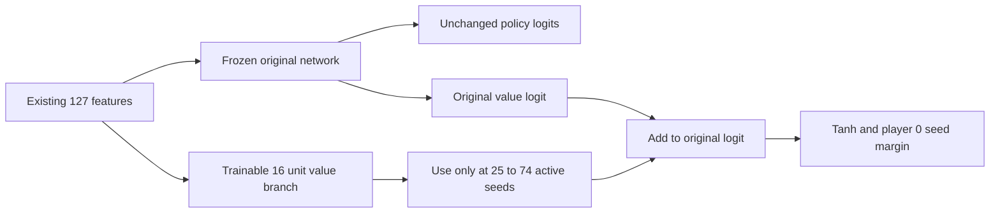

# Small neural value training pilot

Test one small correction to the neural value function while preserving the improved policy. Train against **one target: the existing complete H8 root seed margin**. Freeze the current network and train a separate 2,065-parameter branch. This step produces the plan and dashboard; implementation, optimization and new games remain planned.

The [diagnostics](NEURODIAG_FINDINGS.md) found no output saturation, nearly equal H8 errors for the two fixed heads, changing finite-horizon targets and variable self-play returns. H8-only learning holds the teacher horizon fixed and uses the broadest eligible existing support. This pilot asks whether one bounded neural treatment improves fit and search with a consistent objective. It tests the complete treatment, including additional optimization and its selected data; a gain would not isolate representation capacity as its cause.

## Target and data

For each exact raw board retain its original requested and completed choice-depth **8**, rules digest, teacher configuration, full legal root-action Q values and source hashes. The player-0 target is the maximum Q for controller 0 and minimum Q for controller 1. Capped, substituted-depth or malformed references stop admission. H8 is a finite-horizon teacher estimate; odd margins are valid. H10, H14, successor-position scores, terminal returns and exact-oracle labels never enter gradients.

Let `D=store0-store1`, `a=sum(pits)`, `r=a` for controller 0 and `r=-a` for controller 1. Train toward `z=(H8_margin-D)/r` with normalized Huber loss, delta `0.1`. Require `r!=0` and finite `z` in `[-1,1]`; retain endpoints without clipping or atanh transformation. Controller identity determines the sign, including bonus turns. Unit per-draw weights apply to normalized loss, which is not an equal penalty per seed across active-seed bands.

Use these fixed quotas, with at least two legal choices per root:

| Stratum | Train per actor | Fit check per actor |
|---|---:|---:|
| 50–74 active, ordinary | 64 | 16 |
| 25–49 active, ordinary | 64 | 16 |
| 25–49 active, bonus | 64 | 16 |
| 25–49 active, capture | 64 | 16 |
| Total across both actors | **512** | **128** |

Select 640 globally distinct full family/quotient components using metadata and a fixed hash order before resolving targets or predictions. Rebuild all accumulated origin aliases, evaluation/forensic/trajectory exclusions and allocation/stratum/Q-stability reservations. Exclude the components inspected by NEURODIAG for this pilot's selection; NEURODIAG itself did not create a general optimizer ban. Reserve the whole 128-component fit-check set before optimization. Keep raw states/controllers unchanged; quotient aliases protect ownership and never transfer targets.

Metadata matching indicates these quotas are feasible in the 7,513-root inventory. Implementation must recheck the complete current graph, select fit cases and arena families jointly, and freeze actual IDs/hashes before training. A shortage or failed source check stops the pilot without fillers or outcome-based replacements. The fit-check roots were excluded from this update, but their ancestors trained on the historical corpus. They remain training-source diagnostics, not unseen validation. The pilot does not cover 75–98 active early play.

## Value branch and fixed policy

Initialize from `data/quality-train-v1/model.json`, file SHA-256 `bc1160e99f419b3c1052ea87b28145b622639e6e76a49127c388ab4926d67558`. Freeze **all eight original tensors and all 12,872 parameters**, including the original value head. Preserve the encoder and original policy computation.

For 25–74 active seeds, use `u=u_control+v·ReLU(Ax+b)+c` and `value_player0=D+r*tanh(u)`. The input `x` is the existing 127-feature vector; `A` has 16 rows. Train only `A,b,v,c`: **2,065 parameters**. Initialize `A,b` uniformly within `±1/sqrt(127)` with a dedicated CPU generator, seed `20261016`; set `v,c` exactly zero. Outside 25–74, including terminal positions, bypass the branch and call the frozen value path directly. High-band capture/bonus/pass positions are possible in-domain extrapolation and receive no implied coverage claim.

The combined model has 14,937 parameters. In-domain dense work increases from 12,736 to 14,784 MACs per state, an arithmetic **16.08%** increase; additional FP32 weights occupy 8,260 bytes. These are not latency or electricity measurements. No extra relay simulation is allowed. Measure branch calls/bypasses, feature extraction, base/branch inference, batched CPU throughput and whole-decision time separately.

The current v4 loaders reject extra tensors. Implement a separately versioned export, loader and native evaluator, retaining the existing policy kernel and scale-256 score rounding. Bind base and branch weights, gate, encoder, rules, numeric backend/build, search protocol and input identity in every cache, checkpoint and resumable-job identity. The candidate must have its own complete model digest; the unchanged base digest alone is insufficient. Arena cache remains disabled. GPU training/inference is outside this first pilot.

Before optimization verify zero-branch warm-start equivalence, analytic branch derivatives on synthetic scratch inputs, and native/scalar/batched CPU conformance. Policy logits must be bit-exact against control within each backend. Native versus literal float64 export algebra uses absolute tolerance `1e-10`; Torch FP32 versus export uses maximum `0.001` seed error, `1e-5` logit error and one scale-256 score unit. A tolerance failure stops implementation admission; it does not relax the limits after seeing outcomes. Test actors, bonus/pass/terminal semantics and active boundaries 0,4,5,24,25,49,50,74,75,98. Outside the gate, verify direct value-path equality. Root search outside the band is not generally invariant: descendants of high-active roots can enter it.

## One fixed training run

Use the existing interpreter recorded in `build/training-runtime.json`, on **CPU FP32**, one intra-op/inter-op thread, deterministic algorithms, no AMP, scheduler, dropout, workers or prefetch. Cache exact admitted FP32 inputs and frozen control logits with source/numeric hashes.

| Setting | Fixed value |
|---|---:|
| Optimizer | AdamW, foreach false, fused false |
| Learning rate / weight decay | 0.0003 / 0 |
| Betas / epsilon | 0.9, 0.999 / 1e-8 |
| Gradient L2 clip | 1 |
| Steps / batch / total draws | **400 / 128 / 51,200** |
| Sampling | Uniform among 512 roots, replacement, unit loss weight |
| Dedicated sampler seed | 20261016 |
| Checkpoints | Every 20 steps; also preserve initialization |
| Selected candidate | **Step 400 only** |

Keep all 20 scheduled training checkpoints and the step-0 snapshot. Fit metrics never select a checkpoint, seed, budget or loss. A cooperative stop publishes a compatible intermediate checkpoint without changing the final target step. Stop on nonfinite values, policy/base tensor changes, identity/source/ownership failures or recovery mismatch. No alternative checkpoint or additional run follows a negative result.

Preflight requires at least 4 GiB free Windows commit headroom and physical RAM, plus 2 GiB disk recovery headroom. Training limits are 4 GiB private commit and 20 minutes cumulative active invocation time; new experiment storage is capped at 5 GiB including WAL, checkpoints and retained fixtures. Reserve an invocation allowance durably before launching: two minutes for training and five for arena work. The worker must checkpoint/stop before expiry or durably reserve another allowance before continuing; an independent watchdog enforces the deadline. A clean exit charges actual active time; an unclean exit charges the full reserved allowance, including uncommitted work. An unverified overrun makes the budget indeterminate and holds automatic resume. Further invocations cannot reset an exhausted cumulative cap. A resource stop preserves state and records the reason. Accounting covers the new namespace, rather than accidentally charging the entire historical data tree. CUDA allocation is zero; import/runtime overhead and actual process peaks are reported separately from tensor sizes.

## Fit and search tests

Evaluate control and fixed-final candidate on all 128 fit-check roots: normalized Huber, normalized error, seed MAE/RMSE/bias and actor/stratum results, especially capture. The fit gate requires strictly lower mean normalized Huber and no higher overall or capture seed MAE. These thresholds allocate research only; they do not establish strength.

At 25 and 100 ms, test four engines on 32 metadata-selected fit-check roots, four per cell, and the 32 reused known-exact K≤4 roots: **512 timed case measurements**. Use complete saved H8 action Q values for regret and full optimal-tie accuracy on fit cases. All candidate exact cases must be optimal at both clocks, with zero fallbacks; 16 exact roots have only one legal choice, so this is a regression guard rather than universal endgame proof. Require candidate mean H8 best-action regret no worse than control at each clock.

Run both PUCT profiles at 128 fixed backups on those 64 roots and the five existing H_v1 divergence positions: **138 searches, 17,664 requested backups**. Record actual completion and work and require nonworse same-work regret on the H8 subset. On every tested root with at most 24 active seeds, require exact control/candidate equality of the recommended action, visits, backed-up values and physical search/feature counts at fixed work; exclude timings and branch-bypass bookkeeping from that equality. Active seeds cannot increase along successors, so all their leaves remain on the original value path. Gate boundaries and synthetic scratch fixtures supplement the known low-active capture regression. Exact guards remain separate. Reused forensic roots stay excluded from gradients and from claims of fresh evaluation.

## Both baseline arena

Reserve **24 new-to-arena development families in 24 globally distinct full family/quotient components**, eight each ordinary/capture/bonus. Components must be mutually disjoint and disjoint from current optimizer and fit-check components and earlier arena/case/forensic ownership. A metadata-only count suggests enough candidates; full component matching is a pre-training gate. A shortage holds the plan without lowering the 24-cluster requirement. These families retain historical development/ancestral exposure.

Frozen control and final candidate each face **H_v1 and H8 relay CPU**, both seats, on every family: **192 terminal games**. Use 25 ms whole decisions including reset, feature extraction, inference and validation; floor only the positive remaining search budget, never interpret zero as unlimited. Keep overshoots and fallback work visible. Run one exclusive worker on the existing performance core, group 0/logical 2, after verifying its saved identity. Rotate profile/opponent order and seats.

PUCT stays `c_puct=0.25`, cache 0, 100,000-backup and 2,048-node ceilings, no root noise, and the existing FPU/backup/tie rules. Baselines retain depth ceiling 16, TT 16 MiB and PVS; H8 relay uses the frozen `data/training-stage5-deeper-h8-f127-seed2718/model.json` identity. Its name is not a promise of depth-eight timed search. Cap each game at 512 choices; any cap or fallback blocks a strength conclusion. Arena active time is capped at 90 minutes; interruptions do not reset accumulated work limits.

For each family average the model-perspective seed margins from both seats. Report each profile's absolute margin against each baseline and candidate-minus-control contrasts. Use 4,096 bootstrap resamples of the **24 whole family clusters**, seed `20261019`, preserving all eight games together. Report six exploratory 95% percentile intervals and denominators; games/seats are not independent bootstrap samples.

After all games, retain every transition and recheck the complete actual trajectories using the established ownership predicate for eligible states with active seeds greater than four. Compare against the **frozen 512-root optimizer support and all its origin aliases**, whether drawn or not, and against the 128 fit-check components. A newly discovered cross-role bridge or bridge between arena components blocks strength interpretation and the declared 24-cluster analysis; retain the full result without filtering games, replacing families, merging clusters after outcomes or retraining. Report broader ancestral-corpus overlaps separately; this support is not automatically a new 7,513-root optimizer pool.

## Recovery and independent acceptance

Before production, freeze new sources, runtime, admitted IDs, draw algorithm, settings, export contract and distinct engineering fixtures. Root alone launches production; the independent auditor owns separate fixture/source versions.

Require real training-process kills after a step-4 checkpoint file is fsynced but before catalog commit, and after catalog commit, using a six-step fixture with checkpoint interval two and only the first 32 frozen training roots. One fresh run plus both killed/resumed routes account for 20 expected fixture optimizer-step executions, separate from the 400 production steps. Record all attempted/repeated engineering work, including any retained failed repair attempts. Compare fresh/resumed sidecar and frozen tensors, every optimizer moment, step/draw cursor, sample-prefix digest and all active Python/Torch/dedicated RNG states exactly. Resume from the committed catalog; retain orphan files and never redraw committed work.

Also kill evaluation workers before/after decision and game commits. Preserve raw committed prefixes, clocks and pending-game cursor and prove no committed decision/game is searched twice. Fixed-simulation fixtures must match fresh results exactly; future timed choices may differ with scheduling. Revalidate legal literal transitions and every terminal score.

Completed paths validate certified persisted evidence **before acquiring Work or writer.lock**, following the [Windows repair](NEURODIAG_COMPLETED_READER.md). With optimizer, feature, forward, search and writer entrypoints trapped, completed API/CLI calls must preserve durable bytes/sizes/mtimes. Only a missing derived report may rebuild from valid committed evidence; missing/corrupt required checkpoints, source certificates or caches refuse. Retain failed attempts and bind each accepted method to the source actually executed.

## Decision and dashboard

An identity, overlap, policy or recovery failure invalidates the run and quarantines the candidate. A cap/fallback or exact-guard failure blocks advancement. An otherwise valid negative fit/regret/strength result remains accepted experimental evidence, with the control retained. Require the fit gate, nonworse H8 regret at both clocks and fixed work, and nonnegative paired candidate-minus-control mean margins against **both** baselines to mark the pilot promising for a separately specified confirmation. Intervals crossing zero keep strength inconclusive. Positive lower interval bounds for both contrasts describe exploratory improvement; claiming the candidate beat both baselines additionally requires positive lower bounds for both absolute candidate margins. No outcome automatically promotes a model, expands data, retrains or selects another checkpoint. H_v1 remains the default.

The dashboard will expose nine stages: audited plan, protected split, export/inference, 0–400 training steps, fit/action cases, exact guard, 0–192 arena games, recovery, and final audit/decision. Show planned versus committed counts, 51,200 draws, checkpoint cursor, per-baseline seats, resource clocks, branch/feature work, hard-stop reasons and the next resumable operation. Until implementation, only the plan stage is complete; every execution counter is zero. Preserve the preceding accepted diagnostic dashboard as history.

Implement first: metadata admission/reservations and the versioned native branch with zero-output/policy/domain tests. Admit that interface before the single training run. The [machine-readable plan](../build/valuepilot-plan-v1/plan.json) records the same budgets; the independent plan audit closes the design before implementation.
